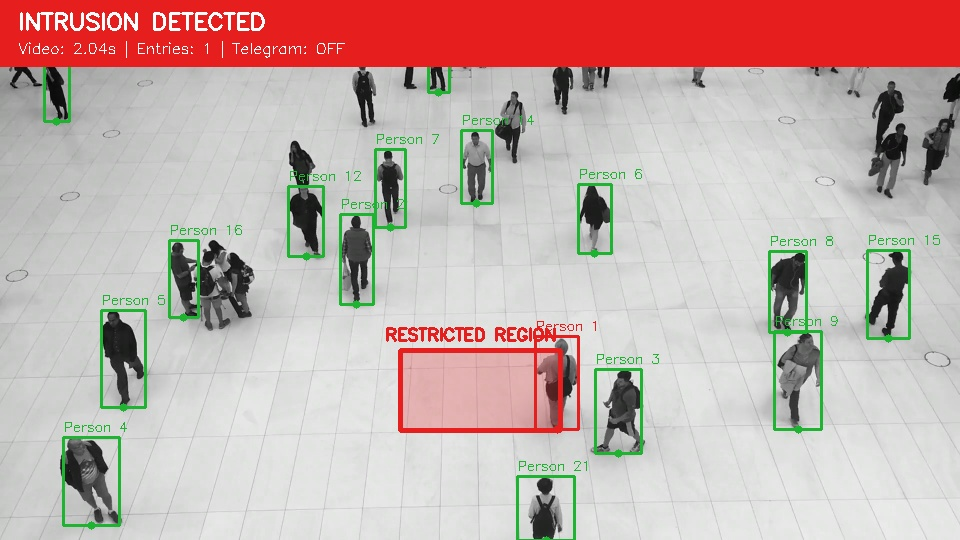

# Tripwire Surveillance — semester project guide

This lab project watches a marked region in recorded video. When a tracked person enters, the display turns red, an **INTRUSION DETECTED** banner appears, and a Telegram alarm can arrive on your phone.

**Submit only `tripwire_surveillance.ipynb`.** This README is your preparation guide. All implementation lives in the notebook. No webcam, training, website, desktop application, ZIP, or separate Python script is required.

## Quick start for teammates

- **[Open the notebook in Google Colab](https://colab.research.google.com/github/guna2007/CV-COURSE-PROJECT/blob/main/tripwire_surveillance.ipynb)** and run its cells in order.
- [Watch/download the annotated result](demo_results/tripwire_result.mp4) without running the notebook. Its saved example uses Telegram OFF.
- [Browse the three ready-to-use 25 FPS input videos](demo_videos). The worker clip is recommended for a one-person, one-alarm presentation.
- Telegram setup is explained in section 2; exact video/region settings are in section 7.



The repository contains the notebook, this guide, three short input clips, and two useful result previews. Downloaded model weights, local environments, and development checks are excluded. For a local clone, the notebook downloads its own standard input automatically. To use an optional clip locally, use its path under `demo_videos/`; for Colab, upload just that chosen MP4 as explained in section 7.

## 1. What to do first

1. Open [Google Colab](https://colab.research.google.com/), choose **File → Upload notebook**, and select `tripwire_surveillance.ipynb`.
2. Optionally choose **Runtime → Change runtime type → T4 GPU** if available. CPU also works; processing speed varies.
3. For a first visual run, leave `SEND_TELEGRAM = False` in section 3.
4. Run the cells from top to bottom, or use **Runtime → Run all**.
5. Wait for processing to finish, then press **Play** on the embedded result in section 6.

The first run needs internet to install packages and download the sample footage and pretrained weights. Everything is initiated by the notebook. A `tripwire_runtime` folder holds generated/downloaded files while it runs; that folder is **not part of your submission**.

The delivered notebook includes a saved visual example. For your own fresh demonstration, run the cells again. Saved example outputs use Telegram OFF and do not prove phone delivery.

## 2. Enable the phone notification

Do this before your presentation. You do not need to give your token to Codex or paste it into source code.

1. Install/open Telegram on your phone.
2. Open the official **@BotFather** account. Send `/newbot` and follow its naming instructions.
3. Copy the token BotFather gives you. Treat it like a password.
4. Open your new bot's chat and press **Start**, or send `hello`.
5. In notebook section 3, change **`SEND_TELEGRAM = False` to `SEND_TELEGRAM = True`**.
6. Run section 3 and paste the token into the hidden prompt. The notebook reads the latest private conversation to obtain your chat ID automatically.
7. Check that the output says **“Private chat found. Phone alarms are enabled.”**
8. Run sections 4–7. Hold your phone ready while **section 5 processes** the footage.

Use a fresh bot for this personal demo and message it only from your own account, because automatic chat discovery chooses the latest private conversation. Keep phone notification permissions enabled if you want a visible notification banner.

**Timing:** a message is sent when processing detects an entry. Replaying the finished video does not send new messages. Processing is not artificially paced to wall-clock playback; several messages may arrive close together. Rerunning section 5 resets tracking and sends the demonstration's messages again.

Each message contains the person ID and **video time**, so you can match it to the event table. `SENT` means Telegram's API accepted the message; confirm its arrival on your phone. Failed deliveries are labelled as failures while video processing continues.

No token or chat ID is printed, stored in the notebook source, or included in the message text. Enter the token through the hidden prompt every new runtime. Before downloading your final notebook, verify you have not manually pasted credentials into a cell.

## 3. Understand the project in plain language

The project has five parts:

| Part | Role |
| --- | --- |
| OpenCV | Reads frames, checks the region, draws annotations, and writes the result |
| YOLO11n | Finds people in each frame using pretrained model weights |
| ByteTrack | Attempts to maintain a consistent ID for each person across frames |
| Region entry rule | Checks a person's location and detects an outside-to-inside transition |
| Telegram | Sends the intrusion message to your phone |

### Detection versus tracking

**Detection** answers “Where are the people in this frame?” YOLO returns bounding boxes, class labels, and confidence scores. The notebook keeps only the COCO `person` class and uses a confidence threshold of 0.35.

**Tracking** answers “Which person is this across successive frames?” ByteTrack associates detections over time using motion and overlap. Its numeric IDs are temporary labels. The project does not identify names or recognise faces.

### Region of interest and the tripwire

The restricted region is a polygon described by four `(x, y)` points. All frames are resized to 960 × 540 before processing, so these coordinates are consistent.

For a box `(x1, y1, x2, y2)`, the monitored point is:

**x = (x1 + x2) / 2, y = y2**

This bottom-centre point approximates where the person stands on the floor. A point-in-polygon test determines whether it is inside. The visible dot on each person's box makes the rule explainable during the demo.

The problem statement mentions a predefined **region**, so the polygon boundary serves as the virtual tripwire. We do not need a second line-crossing mode.

### Why there is only one alarm per entry

For each tracked ID:

1. Three consecutive outside observations arm its alarm.
2. Three consecutive inside observations confirm an entry and trigger one message.
3. Remaining inside leaves the alarm disarmed, preventing a message on every frame.
4. Three consecutive outside observations rearm it for a later re-entry.

At 25 FPS, three frame periods are about 0.12 seconds. This short confirmation reduces boundary flicker. Missing detections reset confirmation streaks but preserve the armed/inside state for that ID. A person first detected inside is marked red after confirmation, but is not counted as an observed entry until they exit and re-enter.

### What was trained?

You do **not** train a model. YOLO11n already has pretrained COCO weights. Our contribution is combining person detection, tracking, geometry, alarm logic, and notification into a demonstrable system. Intrusion-labelled training data is unnecessary because “restricted” is a region we define.

The video is Roboflow Supervision's public `people-walking.mp4` example. The notebook processes its first 10 seconds. It is demonstration input, not a training dataset and not footage we collected. The source is credited in the notebook.

## 4. Notebook sections

| Section | What you run or explain |
| --- | --- |
| 1. Install and import | Installs the small set of packages and selects CPU/GPU |
| 2. Footage and region | Downloads the video and displays the predefined boundary |
| 3. Telegram | Enables phone delivery and privately asks for the bot token |
| 4. Entry logic | Downloads pretrained weights and defines the simple confirmation rule |
| 5. Demonstration | Runs detection, tracking, red alerts, and message delivery |
| 6. Playback | Embeds the annotated H.264 video and first intrusion snapshot |
| 7. Results | Shows IDs, entry times, notification status, and processing rate |

The video is explicitly embedded as notebook output. Saving/downloading the notebook retains it without requiring a separate result video. A static intrusion image is included too, in case a viewer cannot play embedded video.

## 5. A short presentation you can give

**Opening:** “My project monitors a predefined restricted region in recorded surveillance footage and sends an alarm when a person enters it.”

**Show the region:** point to the polygon in section 2. Explain that the bottom-centre dot must cross the boundary, rather than any part of a bounding box merely overlapping it.

**Run the demonstration:** with Telegram enabled, run section 5 while holding your phone. Explain the green-to-red change and show the received message. Processing time depends on the device.

**Replay:** play section 6 and pause near an entry. Point out the person ID, monitored point, red region, banner, and video timestamp. Match it to a table row and phone message. The clear interval at the start provides a useful before/after comparison.

**Explain the logic:** “Detection finds people, tracking follows them, and the region rule generates one alarm per confirmed entry. A confirmed exit rearms the alarm.”

**Close:** “This demonstration uses a pretrained detector, so training is unnecessary. Tracking errors, hidden people, and camera changes are limitations.”

Practise the complete phone-enabled run once before presenting. Saved playback remains useful for explanation, but an OFF-status example is not evidence of message delivery.

## 6. Simple evaluation

For this assignment, use the saved video and event table to check three behaviours:

- **Outside:** people walking outside the region should not generate entry events.
- **Entry:** a person crossing into the region should produce a red alert and one table row.
- **Remaining inside:** the same stay should not create a row on every frame. An exit and subsequent re-entry may legitimately create another event.

Phone delivery is a separate check: match a `SENT` row with the actual received message. The processing FPS includes preview updates and Telegram waits; it is not an isolated model benchmark or a claim of guaranteed real-time speed.

Do not claim a detection accuracy percentage or formal precision/recall from this single clip. A formal accuracy measurement would require manually labelled expected entry events and comparison with predictions.

**Verified saved example:** the complete notebook was executed locally on Windows with Python 3.11.5 and CPU processing, including package setup, public downloads, tracking, video conversion, and embedded outputs. It processed 250 frames (10 seconds) and recorded four entries at **2.04, 4.12, 6.28, and 7.96 seconds**. All 250 generated video frames decoded successfully. The run took about 28 seconds; other hardware may differ. Colab/GPU execution was not directly tested in this environment.

Outside/inside confirmation, repeated-stay suppression, exit/re-entry, and interrupted observations were checked separately. Telegram's accepted, rejected, and network-failure response handling was checked with simulated responses; **actual phone delivery still needs your own bot token and a phone-enabled run**. No real Telegram messages were sent during development.

## 7. Changing the footage, if needed

The default demonstration is ready to use; no changes are required.

To use another short recorded video, upload it to Colab, set `VIDEO_PATH` in section 2 to its filename, and adjust `REGION` using the preview's pixel axes. Keep points in order around the boundary. Start with a view that shows people outside the region before they enter. Rerun sections 2–7 after changing input or region. Increase `MAX_SECONDS` only if your demonstration needs it.

### Downloaded, tested demonstration videos

Three ready-to-use input videos are in **`demo_videos`**, beside the notebook. Each is **10 seconds, 25 FPS, 960 × 540, 250 frames, H.264 MP4**. These are clean input videos; the notebook adds boxes, the restricted region, and alarms when it processes them. They are optional practice/presentation files, not additional submission requirements.

| File | Scene | Confirmed entries in the tested copy | Recommendation |
| --- | --- | --- | --- |
| `01_worker_zone_25fps.mp4` | One worker walking into the chosen floor region | 1, at 5.88 s | **Use this for presenting: one clear crossing and one phone alarm.** |
| `02_indoor_entry_25fps.mp4` | One person walking through an indoor room | 1, at 3.76 s | Simple alternative with an initially empty scene |
| `03_crowd_25fps.mp4` | Several people walking through a public indoor space | 4, at 2.04, 4.12, 6.28, 7.88 s | Demonstrates tracking several people |

The times above are actual local CPU test results using these prepared files and the regions below; small differences on other devices/library versions are possible. Every prepared video was decoded completely and tested using the notebook's YOLO11n, ByteTrack, confidence 0.35, and three-frame confirmation logic. No Telegram messages were sent during these tests.

**Frame-rate honesty:** the worker source is approximately 59.94 FPS and was sampled down to 25 FPS. The indoor source is 12 FPS and was converted to 25 FPS by repeating frames; conversion does not create extra motion detail. The crowd source is already 25 FPS. All copies use the first 10 seconds, are resized to 960 × 540, encoded as H.264, and have audio removed. The algorithm reads video FPS and does not require exactly 25 FPS.

**How to use one in Colab:** upload just your chosen MP4 using the Files sidebar. In notebook section 2, replace the existing `VIDEO_PATH` and `REGION` assignments with the matching two lines below, leaving the rest of the cell unchanged. Then run sections 2–7. For local use, include `demo_videos/` before the filename.

Worker (recommended):

```python
VIDEO_PATH = Path("01_worker_zone_25fps.mp4")
REGION = np.array([[440, 300], [720, 300], [720, 450], [440, 450]], dtype=np.int32)
```

Indoor:

```python
VIDEO_PATH = Path("02_indoor_entry_25fps.mp4")
REGION = np.array([[560, 300], [880, 300], [880, 430], [560, 430]], dtype=np.int32)
```

Crowd:

```python
VIDEO_PATH = Path("03_crowd_25fps.mp4")
REGION = np.array([[400, 350], [560, 350], [560, 430], [400, 430]], dtype=np.int32)
```

For example, the worker's local path is `Path("demo_videos/01_worker_zone_25fps.mp4")`. The zone coordinates remain the same. Keep `MAX_SECONDS = 10`. The default footage download cell may cache its usual sample as well; this does not change your selected `VIDEO_PATH`.

**Sources and attribution:**

- Worker: Intel IoT DevKit sample videos, [`worker-zone-detection.mp4`](https://github.com/intel-iot-devkit/sample-videos/blob/master/worker-zone-detection.mp4), under the repository's [CC BY 4.0 licence](https://github.com/intel-iot-devkit/sample-videos/blob/master/LICENSE). Prepared copy is trimmed, resized, frame-rate converted, and re-encoded.
- Indoor: Intel IoT DevKit sample videos, [`people-detection.mp4`](https://github.com/intel-iot-devkit/sample-videos/blob/master/people-detection.mp4), under the same CC BY 4.0 licence. Prepared copy is trimmed, resized, frame-rate converted, and re-encoded.
- Crowd: Roboflow Supervision public [`people-walking.mp4` demo asset](https://supervision.roboflow.com/0.28.0/assets/). Prepared copy is trimmed, resized, and re-encoded. This is credited example footage, not our original recording.

If you share the optional video copies, retain these source credits and modification descriptions. The supplied default notebook still downloads its own sample and needs no manually uploaded video for its standard run.

## 8. Local VS Code/Jupyter use

Colab is the recommended route. The same file can also run locally:

1. Install Python 3.10 or newer and the VS Code Python and Jupyter extensions.
2. Open `tripwire_surveillance.ipynb` and select a Python notebook kernel.
3. Run its cells in order. Section 1 installs dependencies into that selected environment.
4. Enter your Telegram token through the hidden notebook prompt if delivery is enabled.

You do not need a separate requirements file or application. The hidden `.venv` and `.verification` folders in the development workspace are local implementation/verification artifacts and are not needed by the notebook or submission.

## 9. Common issues

| Symptom | Action |
| --- | --- |
| Setup fails or imports fail | Check internet. In a fresh Colab runtime, rerun from section 1. If prompted to restart after installation, restart and rerun from the top. |
| A download fails | Check internet and rerun the cell. If a partial/corrupt download is suspected, delete just the affected downloaded file from `tripwire_runtime` in the notebook file browser and rerun. |
| “Chat not found” | Check the bot token, press Start/send a message to your new bot, and rerun section 3. |
| Telegram is OFF | Set `SEND_TELEGRAM = True`, rerun section 3, then rerun sections 4–7. |
| Telegram says FAILED | Check connectivity and bot access. Send your bot another message, rerun section 3, then repeat the demo. |
| Video processes slowly | Use an available Colab GPU; allow the short clip to finish. |
| No entry appears with a different video | Recheck the region coordinates and ensure people are observed outside before entering. |
| Embedded player is unavailable | Open the file in Colab/Jupyter and rerun section 6. The saved first-entry snapshot still shows the visual result. |

## 10. Likely viva questions

**Why YOLO11n?** It is a small pretrained person-capable detector with a simple Python interface, suitable for this short lab demonstration.

**Why not just detect a person inside the region?** That would repeatedly alert for the same person. Tracking and transition logic let us count entries and suppress repeated notifications during a stay.

**Why three frames?** A brief confirmation reduces false changes caused by a point jittering around the boundary. It adds a small detection delay.

**Why the bottom-centre?** It approximates the person's floor position better than the centre of their torso. It remains an approximation when feet are hidden or the box is inaccurate.

**Is it real time?** This submission demonstrates the recorded-footage option in the statement. Frames are processed sequentially, but real-time speed is not guaranteed and no webcam/stream interface is included.

**What are the limitations?** Missed detections, occlusion, temporary ID changes, approximate floor position, and a region tied to a fixed camera view. ID changes can lead to missed or duplicate events. Internet and valid Telegram configuration are needed for phone delivery.

**What did you implement?** Region definition, geometric entry checks, confirmation and rearming logic, video annotations, event records, and phone-notification integration around existing detector/tracker components.

## 11. Saving and submission

Use **File → Download → Download .ipynb** in Colab after running. Keep cell outputs so the result video, intrusion snapshot, and event table are retained. Check that the downloaded file opens correctly.

**Submit only `tripwire_surveillance.ipynb`.** Do not submit `tripwire_runtime`, model weights, video files, `.venv`, `.verification`, or this README unless specifically requested. Reopening in a new runtime and running all cells reconstructs the required working files; internet is needed for that fresh run.

## References

- [Ultralytics YOLO11](https://docs.ultralytics.com/models/yolo11/)
- [Ultralytics tracking / ByteTrack](https://docs.ultralytics.com/modes/track/)
- [Roboflow Supervision example footage](https://supervision.roboflow.com/0.28.0/assets/)
- [Telegram bot introduction](https://core.telegram.org/bots)
- [Telegram sendMessage API](https://core.telegram.org/bots/api#sendmessage)
